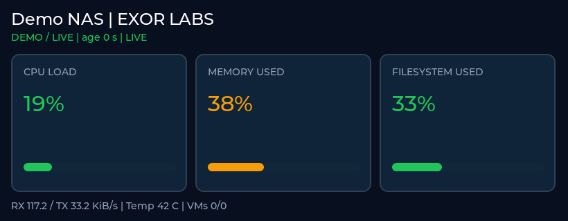

# Exor Labs — live Proxmox/Synology stats on an ESP32 display

Two read-only Python collectors serve one JSON contract. An ESP32-S3 fetches the snapshots and updates an LVGL 9 dashboard on the Waveshare ESP32-S3-LCD-3.16. It alternates Synology and Proxmox views every ten seconds.

The repository includes complete collectors, Docker/Compose deployment files, HTTPS certificate tooling, firmware networking/decoding/UI code, Arduino sketch preparation and tests. Real credentials remain in local ignored configuration files.



This preview is a native render of the included UI and demo-service data. A physical board upload is still a separate deployment check.

## Try the API and decoder without hardware

Python 3.10+; no Python packages to install.

Terminal 1, from this folder:

```bash
python3 tools/demo_servers.py
```

Terminal 2:

```bash
python3 tools/check_endpoints.py --demo
python3 -m unittest discover -s tests -v
```

This first-run mode is deliberately marked `simulated_data`. The live collectors below replace those fixtures. Ports are 4300 for NAS and 4310 for Proxmox; if already occupied, choose free ports in your configuration and update the firmware URLs.

## Deploy the real collectors

Follow [docs/DEPLOYMENT.md](docs/DEPLOYMENT.md). Synology runs the Linux collector in Container Manager/Portainer with host networking and a read-only procfs mount. The Proxmox collector can run in a Linux VM/LXC hosted by Proxmox, or directly as a Python process. It reads the selected PVE node over its authenticated HTTPS API.

| Collector | What it measures | Endpoint aliases |
| --- | --- | --- |
| NAS | CPU deltas, available-memory usage, one filesystem, one chosen NIC, optional hwmon temperature | `/api/v1/stats`, `/nas-stats` |
| Proxmox | Node CPU/RAM/root filesystem/uptime, recent RRD network averages, VM/LXC overview | `/api/v1/stats`, `/stats` |

These endpoints require `Authorization: Bearer YOUR_STATS_TOKEN`. The PVE API token stays on the collector; it is never sent to the ESP32. Unknown readings are `null`, and an unsuccessful poll keeps the previous snapshot with `state: stale`. With no successful sample the endpoint returns 503.

For the Synology filesystem, an empty probe directory on the target volume is enough for `statvfs`. The container does not need a bind mount of every NAS share or access to Docker's socket. For a bonded/USB network setup, configure the correct single interface instead of summing overlapping interfaces.

The PVE storage card is the node's root filesystem. It does not represent all storage pools. PVE's network values are RRD averages, not instantaneous packet counters. Samples older than three minutes are shown as unknown. The VM summary counts all accessible VMs on the selected node; its detailed array is capped at 20.

## Build the complete Arduino sketch

The target board is Waveshare **ESP32-S3-LCD-3.16**, native 320×820, ST7701 RGB panel, 8 MB OPI PSRAM. The firmware is specific to its reviewed vendor display port.

1. Download the official ZIP from https://docs.waveshare.net/ESP32-S3-LCD-3.16/Resources-And-Documents/ .
2. Copy `firmware/config.h.example` to `firmware/config.h`. Fill Wi-Fi credentials, collector HTTPS URLs and stats tokens. Paste your collector `secrets/ca.crt` into `STATS_CA_PEM`. The ESP32 needs a working NTP server to validate certificate dates.
3. Run:

```bash
python3 tools/prepare_firmware.py /path/to/ESP32-S3-LCD-3.16-Demo.zip
```

This creates the full `build/ExorRackStats` sketch plus the matching LVGL library/config in `build/libraries`. It retains the vendor display driver, tick, task and mutex. UI creation occurs at the existing locked site. HTTP runs in a separate FreeRTOS task and passes snapshots through a single-slot queue.

4. Install Espressif Arduino core **3.1.0** and ArduinoJson **7.3.1** using Arduino CLI:

```bash
arduino-cli core update-index --additional-urls https://espressif.github.io/arduino-esp32/package_esp32_index.json
arduino-cli core install esp32:esp32@3.1.0 --additional-urls https://espressif.github.io/arduino-esp32/package_esp32_index.json
arduino-cli lib install ArduinoJson@7.3.1
arduino-cli compile \
  --fqbn esp32:esp32:esp32s3:PSRAM=opi,FlashSize=16M,PartitionScheme=app3M_fat9M_16MB,USBMode=hwcdc,CDCOnBoot=cdc \
  --libraries build/libraries build/ExorRackStats
```

5. Upload locally after identifying the board's port:

```bash
arduino-cli board list
arduino-cli upload -p YOUR_BOARD_PORT \
  --fqbn esp32:esp32:esp32s3:PSRAM=opi,FlashSize=16M,PartitionScheme=app3M_fat9M_16MB,USBMode=hwcdc,CDCOnBoot=cdc \
  build/ExorRackStats
```

Arduino IDE users can open `build/ExorRackStats/ExorRackStats.ino`. Install the matching vendor LVGL 9 library and `lv_conf.h` in the IDE's library directory, plus ArduinoJson 7.3.1, then use the same core/PSRAM/flash settings. Avoid competing LVGL installations for the build.

For portrait, create a separate output: `python3 tools/prepare_firmware.py ZIP --portrait --build-dir build-portrait`.

## Source structure

| Path | Purpose |
| --- | --- |
| `server/rackstats_agent/` | Real NAS/PVE collectors, cache, token-protected HTTP/HTTPS server |
| `.env.*.example` | Public configuration templates; copy to local `.env.*` |
| `deploy/` | Dockerfile and two independent Compose stacks |
| `firmware/ExorRackStats.ino` | Arduino entry point |
| `firmware/network.cpp` | Wi-Fi, TLS, token-authenticated polling and snapshot queue |
| `firmware/parse_snapshot.h` | The decoder used by ESP32 and native integration tests |
| `firmware/ui.c` | LVGL dashboard, stale/unknown rendering, automatic page switching |
| `tools/prepare_firmware.py` | Creates the complete vendor-compatible sketch |
| `tools/make_tls.py` | Creates your local CA and collector certificates |
| `tests/` | Collector normalization, HTTP authorization, stale behavior and TLS tests |

## What has been tested

The complete firmware compiled for ESP32-S3 with core 3.1.0, LVGL 9.3.0 and ArduinoJson 7.3.1. The server tests include real HTTP requests, verified HTTPS and rejection of an untrusted certificate. The same C++ JSON decoder used by the firmware was compiled natively and fed HTTP server payloads, including null/stale/invalid-schema cases. Linux procfs collection was executed in the authoring environment.

Physical board upload, your Synology Docker deployment and your authenticated PVE installation need their first local deployment checks. The Proxmox adapter was tested against a matching API fixture, not your private host. Docker is not available in the authoring environment, so no built-container execution is claimed. See the root validation report for exact results.
